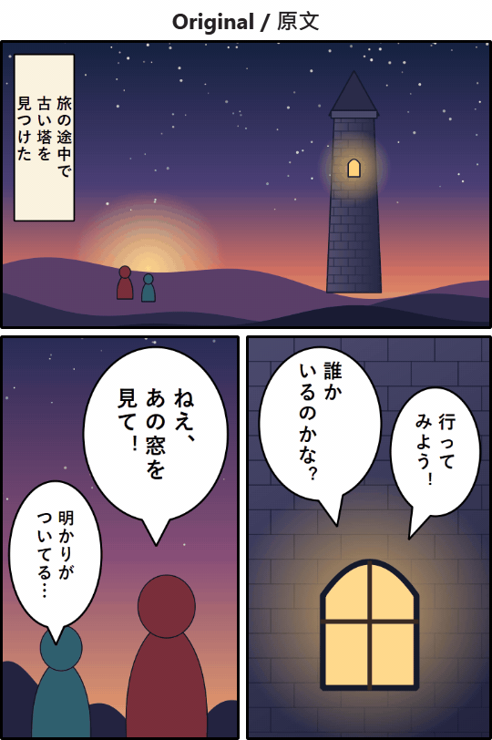

# 巴別塔之窗

[English](README.md) | **繁體中文**

一塊可以移動的翻譯視窗，能翻譯視窗後方的任何內容。把它放到漫畫、遊戲、應用程式或網頁上，視窗內的文字就會被讀取、翻譯，並以你選擇的語言重新寫回畫面。

所有處理都在你自己的電腦上進行，不需要帳號、API 金鑰或雲端服務。



*示範頁為本專案原創繪製。各語言都是程式以高檔模型實際輸出的結果，以截圖循環顯示。想親自試試，可開啟[原圖](docs/demo-original.png)。*

## 功能

- **螢幕上任何地方都能用：** 漫畫、遊戲、應用程式、網頁。
- **保留原本的版面：** 找出文字、抹去原文，再把譯文寫回原位；原文直排時，中文和日文譯文也會直排。
- **譯文語言：** 繁體中文、English、日本語、한국어。
- **自動模式：** 畫面停止變動後自動重新讀取。
- **記住人名：** 每部作品各有一份人名清單。譯文改過一次就會記住。
- **按住查看原文：** 不必關閉視窗就能對照原文。
- **自選字型：** 可在程式內下載免費字型，也可加入自己的字型檔。
- **介面語言：** English、繁體中文、廣東話，並提供淺色和深色主題。

## 系統需求

- Windows 10 或 11（x64）
- 8 GB VRAM 或以上的顯示卡（見下方模型檔次）
- [Ollama](https://ollama.com/download)
- Python 3.10
- 約 4 至 13 GB 可用硬碟空間，視模型檔次而定

## 安裝

1. 安裝 Ollama 和 Python 3.10。
2. 開啟 PowerShell，執行：

```powershell
git clone https://github.com/Nikola-zip/Window-of-Babel.git
cd Window-of-Babel
py -3.10 -m venv .venv
.venv\Scripts\pip install -r requirements.txt
.venv\Scripts\python -W ignore main.py
```

3. 首次開啟時，設定視窗會檢查 Ollama、讀取 VRAM，並建議一個模型檔次。按下按鈕，程式就會下載所需的檔案。

之後如要建立桌面捷徑，請開啟「設定」→「一般」，按「建立桌面捷徑」。

## 模型檔次

| 檔次 | 讀字 | 翻譯 | VRAM 用量 | 建議顯示卡 | 下載量 | 適合 |
|---|---|---|---|---|---|---|
| 輕 | Qwen3-VL 2B | Hy-MT2 1.8B | 約 6 GB | 8 GB | 3.7 GB | 清晰的橫排文字；手寫字和小字較易出錯。 |
| 中 | Qwen3-VL 8B | Hy-MT2 1.8B | 約 10 GB | 12 GB | 7.9 GB | 文字幾乎全部讀對；翻譯品質約為高檔的九成，速度快一倍。 |
| 高 | Qwen3-VL 8B | Hy-MT2 7B | 約 15 GB | 16 GB 或以上 | 12.6 GB | 最準確。 |

以上數字已包括找字和抹字所需的約 1.7 GB VRAM 和 0.3 GB 下載量。你隨時可在「設定」→「模型」轉換檔次。

**測試環境：** Windows 11、RTX 4090（24 GB）、Ollama 0.40.6。三個檔次都在這張顯示卡上執行過；較小顯示卡的 VRAM 數字是估算值，AMD 和 Intel 顯示卡未經測試。

## 已知限制

- 複雜背景（例如磚牆）上的擬聲字和有外框的文字，可能無法完全抹除。你可在「設定」→「窗」關閉翻譯擬聲字。
- 窗不會出現在截圖和螢幕錄影中，這樣才不會讀到自己的譯文。如要保存翻譯畫面，請按工具列的 📷。

## 預設快速鍵

| 按鍵 | 功能 |
|---|---|
| Ctrl+Alt+T | 讀字翻譯 |
| Ctrl+Alt+G | 調整窗 |
| Ctrl+Alt+A | 自動模式 |
| Ctrl+Alt+V | 按住查看原文 |
| Ctrl+Alt+H | 歷史面板 |
| Ctrl+Alt+N | 清空翻譯上下文 |

你可在「設定」→「快速鍵」更改。部分遊戲會封鎖全域快速鍵，所以視窗的工具列也有相同的功能。

## 私隱

程式只擷取視窗覆蓋的範圍，並在你的電腦上處理。只有在你要求時才會連線：

- 設定時下載模型
- 下載字型
- 按下「線上查詢譯名」，此時只會傳送你輸入的作品名稱和條目名稱

你的設定和人名清單都保存在程式資料夾內，以下兩項也一樣：

- **紀錄：** `logs\` 會保存視窗讀到的原文和譯文。超過「設定」→「一般」的保留日數（預設 30 日）後，會在下次開啟時刪除；你也可以隨時自行刪除。
- **截圖：** 只有按下 📷 才會存到 `screenshots\`，並會一直保留，直到你自行刪除。

## 使用守則

巴別塔之窗只供個人閱讀。請勿公開分享翻譯後的頁面，並支持你喜愛作品的正版。

程式只會擷取畫面，不會把程式碼注入遊戲，也不會讀取遊戲記憶體。不過每款遊戲的規則不同，在網上遊戲使用前請先查閱，使用時須自行負責。

## 專案狀態

這是興趣專案，不保證會回覆或修正問題。

## 授權

巴別塔之窗以 [GNU General Public License v3.0](LICENSE) 發佈。

第三方模型和套件各有自己的條款，詳見 [THIRD_PARTY_NOTICES.md](THIRD_PARTY_NOTICES.md)（英文）。
